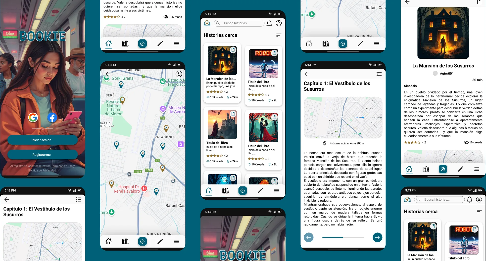

# Bookie

**Stories you unlock in the real world, one chapter at a time.**

A mobile reading app where each chapter unlocks only when the reader reaches a specific place. Built in a cross-functional team during a No Country hackathon (December 2024). **Hackathon finalist.**

My role: **UX/UI Designer**, from the client's user story to the brand, the flows and the navigable prototype.

**Prototype:** [Figma](https://www.figma.com/proto/hps5pgUhOIUXp7aydqOWMq/Bookie?page-id=0%3A1&node-id=145-3121&starting-point-node-id=145%3A3121) · **Case study:** [portfolio](https://sofia-alvarez-ux-iu.vercel.app/#/case-study/bookie) · **App code (team):** [No-Country-simulation/h3-14-bookie](https://github.com/No-Country-simulation/h3-14-bookie)

## The challenge

The client knew the story they wanted to tell (an app that unlocks chapters when you physically arrive at a location) but not how it should work inside the app. Reading apps treat reading as a passive activity, disconnected from the place you are in, and amateur writers have few creative ways to share their work.

## What I did

- **Benchmark** of three reading platforms. They all shared the same pattern: reading disconnected from the physical world. Bookie's differentiator was real; the challenge was making it clear from the first screen.
- **User types and flows.** I identified different usage logics for readers and writers and kept them in separate flows, so the reader never has to mix "reading mode" and "exploring mode".
- **The critical screen.** The transition between chapters: the reader has just finished reading and needs to know right away where to go next. I designed a dedicated screen with the next location on the map, the estimated distance and a preview of the next chapter (Nielsen's visibility of system status).
- **Brand and UI kit.** Systematized typography (Roboto + Recursive), tokenized palette, custom icons and illustrations, and reusable components for the development team.
- **Validation.** No real users were available during the hackathon, so iterations were based on Nielsen's heuristics. The natural next step would be usability testing with readers of apps like Wattpad.

## Product scope

- Sign up and login (Auth0)
- Story creation: pick places, write chapters and link each one to a location
- Story feed organized by proximity and read / unread status
- Reading: chapters unlock by GPS, with navigation to the next location (Google Maps)

## Stack (team)

Flutter · Firestore · Auth0 · Google Maps · Figma

## Repository contents

- [`Activos-Imagenes/`](Activos-Imagenes) Icons, logo and illustrations exported for development (SVG)
- [`docs/`](docs) Screens of the final prototype

## Team

| Name | Role | Links |
|---|---|---|
| Rodrigo Cordoneda | Team Leader | [LinkedIn](https://www.linkedin.com/in/rodrigocordoneda/) |
| Cristian Cerón | Product Manager | [LinkedIn](https://www.linkedin.com/in/cristianceronb/) |
| **Sofía Álvarez** | **UX/UI Designer** | [LinkedIn](https://www.linkedin.com/in/sof%C3%ADa-%C3%A1lvarez-20/) · [GitHub](https://github.com/Sofi-Alvarez) |
| Valentina Molina | UX/UI Designer | |
| Jhosep Tinta Mancilla | Front-end | [LinkedIn](https://www.linkedin.com/in/jhosep-tinta/) · [GitHub](https://github.com/JhosepTM) |
| Jose Luis Huanca | Front-end | [LinkedIn](https://www.linkedin.com/in/joseluishc/) · [GitHub](https://github.com/JoseLuisHcoder) |
| Daniel Matos | Back-end | [GitHub](https://github.com/Daniel-M12) |
| Maximiliano Echeverría | Back-end | [LinkedIn](https://www.linkedin.com/in/maximiliano-echeverria/) · [GitHub](https://github.com/MaximilianoEcheverria) |
